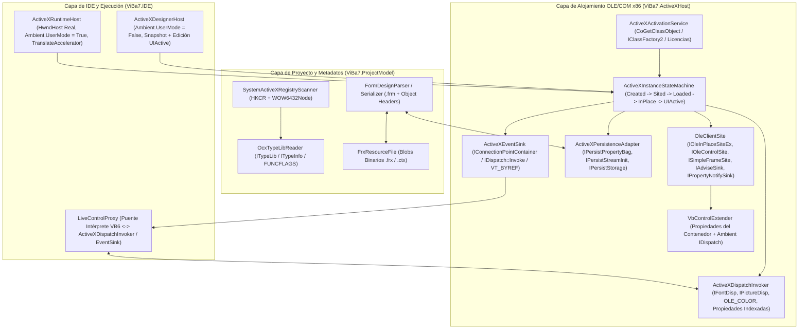

# Diagnóstico Comparativo y Plan de Acción: Soporte ActiveX / OCX al 100% (Paridad VB6 x86)

Este documento contrasta la especificación técnica de [Manual_Tecnico_ActiveX_OCX_IDE_x86.txt](../Manual_Tecnico_ActiveX_OCX_IDE_x86.txt) con la implementación actual del IDE (`ViBa7.ActiveXHost`, `ViBa7.ProjectModel` y `ViBa7.IDE`), identificando las brechas técnicas y estableciendo la hoja de ruta de ingeniería para alcanzar el **Nivel H (100% de compatibilidad con VB6)**.

---

## 1. Diagnóstico Comparativo: Manual Técnico vs. Implementación Actual

> [!IMPORTANT]
> **Estado Global Actual**: El IDE se encuentra entre el **Nivel C y D (~42% de cobertura total)**. El proceso corre en `x86` STA, descubre controles en `WOW6432Node`, lee TypeLibs con liberación de memoria nativa, instancia OCX mediante `CoCreateInstance` en un contenedor estacionado offscreen (`_sharedParkingHwnd`) y captura snapshots visuales en modo diseño. Sin embargo, **carece de ejecución interactiva en tiempo real (Runtime), sumidero de eventos COM (`IConnectionPoint`), persistencia binaria `.frx` (`IPersistStreamInit`/`IPersistStorage`), contenedor extendido (`VBControlExtender`) y licencias (`IClassFactory2`)**.

### 1.1 Matriz de las 12 Áreas Funcionales (Sección 1 del Manual)

| # | Área Funcional (Manual) | Cobertura | Implementado Actualmente | Brecha para el 100% (Faltante) |
| :--- | :--- | :---: | :--- | :--- |
| **1** | **Descubrimiento y registro** | **85%** | `SystemActiveXRegistryScanner` escanea `HKCR\TypeLib`, `WOW6432Node\CLSID`, valida PE `IMAGE_FILE_MACHINE_I386` (`0x014C`), soporta `regsvr32` y filtra rutas inválidas. | Registro aislado (Reg-Free COM / manifiestos SxS) y caché persistente en disco con invalidación por timestamp/hash del `.ocx`. |
| **2** | **Introspección TypeLib** | **80%** | `OcxTypeLibReader` usa `LoadTypeLibEx(REGKIND_NONE)`, extrae `TKIND_COCLASS`, interfaz default, interfaz de eventos (`IMPLTYPEFLAG_FSOURCE`), `DISPID`, `TKIND_ENUM`, y libera `TLIBATTR`/`TYPEATTR`/`FUNCDESC`/`VARDESC`. `OcxToolboxBitmapExtractor` usa `LOAD_LIBRARY_AS_DATAFILE`. | Extracción de `FUNCFLAGS` (`FUNCFLAG_FIMMEDIATEBIND`, `FUNCFLAG_FDEFAULTBIND`, `FUNCFLAG_FDISPLAYBIND`, `FUNCFLAG_FHIDDEN`, `FUNCFLAG_FNONBROWSABLE`), `VARFLAGS`, subtipos `OLE_COLOR`, `OLE_OPTEXCLUSIVE`, `IFontDisp` e `IPictureDisp` para editores especializados. |
| **3** | **Inserción en el proyecto** | **75%** | `ComponentsWindow` y `ToolboxPanel` agregan herramientas con ícono nativo; `VbpParser` lee/escribe `Object={GUID}#ver#lcid; archivo.ocx`. | Validación de bloqueo al desmarcar un componente en uso en formularios abiertos y actualización automática de versión mayor/menor cuando el sistema tiene una versión superior compatible. |
| **4** | **Alojamiento visual en diseñador** | **55%** | `ActiveXInPlaceHost` y `DynamicActiveXControl` crean la instancia COM, aplican `MaskFpuExceptions` y `NativeDialogGuard`, y renderizan vía `OleDraw` + `PrintWindow` sobre `_sharedParkingHwnd`. | **No existe máquina de estados OLE formal** (`Created -> Sited -> Loaded -> Visible -> InPlaceActive -> UIActive`). Falta `IAdviseSink` / `IViewObject::SetAdvise` para repintado asíncrono, modo *UI-Active* en diseño (ej. cambiar pestañas en `SSTab` en diseño) y `ISimpleFrameSite` para OCX contenedores. |
| **5** | **Propiedades y páginas de propiedades** | **60%** | `PropertyGridPanel` muestra propiedades del TypeLib, y `DynamicActiveXControl.ShowPropertyPages` invoca `ISpecifyPropertyPages` + `OleCreatePropertyFrame`. | Falta `IPropertyNotifySink` (`OnChanged` / `OnRequestEdit`) para sincronizar cambios desde las páginas de propiedades nativas hacia el `PropertyGridPanel` y marcar el `.frm` como modificado; falta `IPerPropertyBrowsing` y el objeto extendido `VBControlExtender`. |
| **6** | **Persistencia `.vbp`/`.frm`/`.frx`** | **35%** | `FormDesignParser` lee cabeceras `Object =`, propiedades escalares (`CustomProperties`) y preserva controles no resueltos (`IsUnresolved`). `OlePropertyBag` lee/escribe escalares básicos. | **Brecha crítica**: `FormDesignSerializer` **no emite** líneas `Object = "{GUID}#ver#0"; "file.ocx"` al guardar el `.frm`. `FrxResourceFile` solo soporta imágenes (`0x0000746C`), **no persiste streams binarios de OCX** (`IPersistStreamInit::Load/Save` hacia `.frx`, `Object.zyx = "Form1.frx":0000`, `IPersistStorage`). |
| **7** | **Eventos COM** | **15%** | `OcxTypeLibReader` extrae las firmas de eventos (`OcxEventInfo`) del TypeLib. | **0% de conexión en vivo**: No existe implementación de `IConnectionPointContainer`, `IConnectionPoint::Advise` ni sumidero `IDispatch` (`ActiveXEventSink`). Tampoco se inyecta el parámetro `Index As Integer` en arreglos de controles OCX ni se propagan argumentos `ByRef` (`VT_BYREF`). |
| **8** | **Automatización / IntelliSense / Código** | **65%** | `VbControlMemberCatalog` fusiona miembros del TypeLib con propiedades de ubicación para autocompletado. | El doble clic sobre un OCX en el diseñador no genera el procedimiento del evento predeterminado (`IMPLTYPEFLAG_FDEFAULT` / `DISPID_VALUE` o primer evento de la interfaz source) con su firma exacta de parámetros VB6. Falta soporte de propiedades indexadas (`TextMatrix(r, c)`) y tipos `IFontDisp`/`IPictureDisp`. |
| **9** | **Modo ejecución dentro del IDE (F5)** | **10%** | `LiveFormWindow` muestra el formulario en ejecución y `LiveControlProxy` expone propiedades de controles intrínsecos al intérprete. | **Brecha crítica**: En modo ejecución (`F5`), los OCX caen en el `default:` de `LiveFormWindow.CreateLiveControlVisual`, mostrando una imagen estática de diseño sin HWND interactivo, sin `Ambient.UserMode = True`, sin eventos y sin puente `IDispatch` en `LiveControlProxy`. |
| **10** | **Compilación y salida ejecutable** | **25%** | `Vb6ProjectCompiler` traduce formularios y módulos a un proyecto intermedio. | El generador de código compilado no instancia los OCX por `CLSID` con su estado binario `.frx`, clave de licencia `IClassFactory2::CreateInstanceLic` ni enlaza sus eventos COM en el ejecutable final x86. |
| **11** | **Manejo de errores y aislamiento** | **55%** | `DynamicActiveXControl` implementa `MaskFpuExceptions` (`_control87`) y `NativeDialogGuard` (`WH_CBT`). | Múltiples bloques `catch { }` silenciosos ocultan el `HRESULT`, la etapa de fallo y `IErrorInfo`. Falta telemetría de fugas de referencias COM (`AddRef`/`Release`), handles GDI y `HWND` al cerrar formularios. |
| **12** | **Soporte `UserControl` (`.ctl`/`.ctx`)** | **25%** | El IDE abre archivos `.ctl` en el diseñador y los parsea. | Falta el motor de ciclo de vida de `UserControl` (`Initialize`, `InitProperties`, `ReadProperties`, `WriteProperties`, `Resize`, `Paint`, `Terminate`), objetos `Ambient` y `Extender`, persistencia en `.ctx` y compilación de proyectos `Type=Control` a `.ocx`. |

---

## 2. Arquitectura Objetivo para el 100% de Paridad VB6

---

## 3. Plan de Acción Detallado por Fases (Hitos 1 al 8)

### Fase 1: Persistencia Fiel `.vbp` / `.frm` / `.frx` y Ciclo de Vida OLE (Hitos 2 y 3 del Manual) — [COMPLETADA]
1. **[x] Emisión de Cabeceras `Object =` en `.frm`** (`FormDesignSerializer.cs`, `FormDesignParser.cs`, `VbControlMemberCatalog.cs`): Serializar al inicio del `.frm` todas las entradas `ObjectDeclarations` y referencias OCX activas con formato `Object = "{GUID}#major.minor#lcid"; "NombreArchivo.ocx"`, preservando bloques `BeginProperty` anidados y propiedades con puntos/índices (`Object.zyx`, `TabCaption(0)`).
2. **[x] Soporte de Blobs Binarios ActiveX en `.frx` y `.ctx`** (`FrxResourceFile.cs`, `FormDesignParser.cs`): Leer y escribir bloques binarios arbitrarios referenciados mediante `Object.zyx = "Form1.frx":0000` y propiedades binarias preservando intactos los offsets existentes (`OriginalFrxBytes`).
3. **[x] Adaptador de Persistencia COM Completo** (`DynamicActiveXControl.cs`, `Ole32Interop.cs`, `ActiveXInPlaceHost.cs`): Implementar `CreateStreamOnHGlobal`, `IPersistStreamInit::Load/Save`, `IPersistStream::Load/Save`, `IPersistStorage` y soporte de `byte[]` (`SAFEARRAY(VT_UI1)`) en `VbPropertyBag`.
4. **[x] Máquina de Estados OLE y Licencias (`IClassFactory2`)**: Soportar `GetLicInfo`, `RequestLicKey` y `CreateInstanceLic`, formalizando las transiciones `Uninitialized -> Created -> Sited -> Loaded -> Visible -> InPlaceActive -> UIActive -> Disposed` y el registro diagnóstico estructurado.

### Fase 2: Contenedor OLE Completo, `VBControlExtender`, Tipos COM y `PropertyNotifySink` (Hito 3 y Sección 5) ✅ COMPLETADA
1. **[x] `IPropertyNotifySink` e `IAdviseSink`**: Sincronizar cambios realizados desde páginas de propiedades nativas (`OleCreatePropertyFrame`) hacia el `PropertyGridPanel` y refrescar el snapshot ante repintados asíncronos (`IViewObject::SetAdvise`).
2. **[x] Objeto Extendido (`VBControlExtender`) y `TransformCoords`**: Implementar `IOleControlSite::GetExtendedControl` y conversión matemática real entre `HIMETRIC` (`2540/in`) y `Twips` (`1440/in`).
3. **[x] Propiedades Ambientales Completas**: Soportar `DISPID_AMBIENT_FONT (-703)` (`IFontDisp`), `DISPID_AMBIENT_PALETTE (-726)` y `OnAmbientPropertyChange`.
4. **[x] Conversión Avanzada de Tipos COM**: Soportar `StdFont`/`IFontDisp`, `StdPicture`/`IPictureDisp`, `OLE_COLOR`, `SAFEARRAY` y propiedades indexadas (`TextMatrix(r, c)`).

### Fase 3: Alojamiento Interactivo en Modo Ejecución (`ActiveXRuntimeHost`) y Puente de Automatización (Hitos 4 y 5) ✅ COMPLETADA
1. **[x] Creación de `ActiveXRuntimeHost` (`HwndHost` Real)**: Alojar el `HWND` nativo del OCX en `LiveFormWindow` con `Ambient.UserMode = True`, transfiriendo el estado persistido en diseño y delegando teclado a `IOleInPlaceActiveObject::TranslateAccelerator`.
2. **[x] Integración con `LiveFormWindow` y `LiveControlProxy`**: Enrutar `GetProperty`, `SetProperty` (incluyendo propiedades indexadas) e `InvokeMethod` al `IDispatch` del control y sus subobjetos COM (`Nodes`, `ListItems`, `ColumnHeaders`).
3. **[x] Activación UI-Active en Diseño (`OLEIVERB_UIACTIVATE`) e `ISimpleFrameSite`**: Permitir edición interactiva in-place en diseño (ej. cambiar pestañas en `SSTab`) y contención de controles hijos.

### Fase 4: Eventos COM en Vivo (`IConnectionPoint` / `ActiveXEventSink`) (Hito 4) ✅ COMPLETADA
1. **[x] Implementación de `ActiveXEventSink`**: Conectar la interfaz `IMPLTYPEFLAG_FSOURCE` mediante `IConnectionPointContainer::FindConnectionPoint` y `Advise`, despachando llamadas `IDispatch::Invoke` por `DISPID` respetando el orden inverso de la ABI COM (`rgvarg[cArgs - 1 - i]`) y puenteando objetos COM hijos a `LiveComDispatchProxy`.
2. **[x] Soporte de `VT_BYREF` e `Index`**: Propagar cambios en argumentos `ByRef` (`KeyAscii`, `Cancel`, `Button`, `Shift`, etc.) de vuelta al llamador nativo en memoria COM e inyectar `Index As Integer` como primer argumento en matrices de controles OCX (`ctrl.Index.HasValue`).
3. **[x] Generación de Stubs de Eventos en el Editor**: Generar la firma exacta del evento predeterminado del TypeLib (`VbControlMemberCatalog.TryGetDefaultEvent`, `MSFlexGrid` -> `RowColChange`, `TreeView` -> `NodeClick(ByVal Node As Node)`, `ListView` -> `ItemClick(ByVal Item As ListItem)`, `SSTab` -> `Click(PreviousTab As Integer)`, etc.) al hacer doble clic sobre un OCX en el diseñador.

### Fase 5: Compilación Nativa/Ejecutable y Soporte `UserControl` `.ctl`/`.ctx` (Hitos 6 y 7) ✅ COMPLETADA
1. **[x] Compilación de Proyectos con OCX (`Vb6ProjectCompiler.cs`)**: Detección automática de dependencias OCX, configuración de `wExternalComponentCount` en `VBHeader` de la estructura nativa PE/MSVBVM60, e integración de `Vb6ManifestGenerator` para emitir manifiestos SxS Reg-Free COM (`.exe.manifest` con `<file>`, `<comClass>` y `<typelib>`).
2. **[x] Motor Completo de `UserControl` (`.ctl`/`.ctx`)**: Implementación de `VbPropertyBagRuntime` (`ReadProperty`, `WriteProperty`, serialización binaria canónica), objetos intrínsecos `Ambient` (`VbUserControlAmbient`) y `Extender` (`VbUserControlExtender`), ciclo de vida interactivo (`Initialize`, `InitProperties`/`ReadProperties`, `Resize`, `Show`, `Paint`, `Hide`, `Terminate`) e instrucción `RaiseEvent` en el intérprete enrutando eventos al formulario contenedor.

### Fase 6: Batería de Pruebas de Aceptación y Telemetría de Estabilidad (Hito 8 y Sección 19) ✅ COMPLETADA
1. **[x] Diagnóstico Estructurado y Telemetría COM (`ActiveXDiagnosticsLogger.cs`)**: Registro thread-safe de telemetría de bajo nivel para cada etapa del ciclo de vida `{ Stage, Clsid, ProgId, ControlName, Iid, HResult, HResultHex, ErrorInfoDescription, ThreadId, IsStaThread, TimestampUtc, Detail }` con captura automática de `IErrorInfo` nativo (`GetErrorInfo`), verificación de apartamento STA y exportación de reportes diagnósticos a texto y JSON estructurado.
2. **[x] Monitor de Recursos de Bajo Nivel y Fugas (`ActiveXResourceMonitor.cs`)**: Supervisión de handles nativos GDI y USER mediante P/Invoke de `GetGuiResources` (`GR_GDIOBJECTS`, `GR_USEROBJECTS`), memoria del proceso y balance estricto de referencias COM activas (`TrackComObjectCreated` / `TrackComObjectReleased`).
3. **[x] Batería de Pruebas de Aceptación y Estrés de 100 Ciclos (`Phase6ActiveXAcceptanceAndStabilityTests.cs`)**: Batería automatizada según la Sección 19 del Manual Técnico cubriendo:
   - Catálogo y descubrimiento de controles ActiveX de referencia (`MSFlexGrid`, `TreeView`, `ListView`, `SSTab`, `RichTextBox`, `ProgressBar`, `StatusBar`, `Slider`, `TabStrip`, `Winsock`, `MSComm`, `WebBrowser`).
   - Prueba de estrés de 100 ciclos de instanciación y liberación con verificación de estabilidad de handles (tolerancia acotada a cachés del SO).
   - Resiliencia y preservación al 100% de datos desconocidos en controles ausentes/no registrados sin corrupción del `.frm`.
   - Despacho de eventos COM con mutación bidireccional `ByRef` e inyección de `Index As Integer` en matrices de controles.
   - Fidelidad en transformaciones métricas HIMETRIC <-> Twips dentro de 1 Twip de tolerancia.
